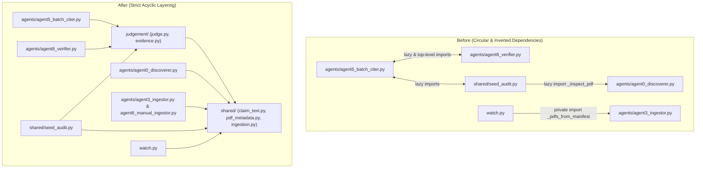

# Agent Architecture Refactoring Execution Plan (`code.md`-Compliant)

> [!IMPORTANT]
> **Mandatory Pre-Flight Rule for the Executing Agent:**
> Before writing or editing a single line of code, read [`code.md`](file:///Users/shardul/Downloads/marvin/migration-source/research_assistant/code.md) in full. Every change in this plan is governed by the four principles of [`code.md`](file:///Users/shardul/Downloads/marvin/migration-source/research_assistant/code.md):
> 1. **Think Before Coding** — Surface assumptions, check caller/test impacts before editing, and stop if a dependency or mock target behaves unexpectedly.
> 2. **Simplicity First** — Minimum code that solves the concrete structural defect. **Do NOT** introduce a speculative `BaseAgent` class hierarchy, dependency-injection framework, or unrequested configuration knobs.
> 3. **Surgical Changes** — Touch only the lines required for the current phase. Preserve existing formatting, comments, CLI flags, and module-level symbols imported or patched by tests.
> 4. **Goal-Driven Execution** — Execute one phase at a time using the explicit `Step -> verify: [pytest command]` loop. Never proceed to the next step until the current verification command passes 100%.

---

## 0. Environment, Baseline Verification & Protected Mock Targets

### 0.1 Test Runner & Working Directory
All commands must be executed from `/Users/shardul/Downloads/marvin/migration-source/research_assistant` using the local Python 3.12 virtual environment:

```bash
cd /Users/shardul/Downloads/marvin/migration-source/research_assistant
.venv/bin/pytest -q
```

### 0.2 Data Safety Guardrail
- **Never** run destructive extraction or ingestion against live workspace directories (`raw/`, `pulled_pdfs/`, `vectordb/`) during refactoring.
- All verification must run through `pytest` using `tmp_path` fixtures.

### 0.3 Protected `unittest.mock.patch` & `monkeypatch` Targets
Because existing tests use `unittest.mock.patch("module.symbol")` and `monkeypatch.setattr(module, "symbol", ...)`, moving a function to a shared module **without** keeping its lookup bound to the original module namespace will break tests even if the symbol is re-exported.

> [!CAUTION]
> **Critical Rule for Extracting Shared Helpers:**
> Whenever a helper is extracted from Module A into Module B, if tests patch `ModuleA.dep_fn` (for example `hybrid_search`, `chat`, `judge`, `_judge_once`), Module A's wrapper **must pass its own module-level symbol** into Module B (e.g., `search_fn=hybrid_search`, `judge_fn=judge`) or keep the orchestration loop in Module A and only share pure data-transformation helpers.

The following module attributes are actively patched across `tests/` and **must remain bound and effective** when patched on their original module:

| Module | Patched Attributes in `tests/` (`patch` / `monkeypatch.setattr`) |
| :--- | :--- |
| [`agent0_discoverer.py`](file:///Users/shardul/Downloads/marvin/migration-source/research_assistant/research_assistant/agents/agent0_discoverer.py) | `requests.get`, `time.sleep`, `DISCOVERY_DIR`, `RAW_DIR`, `PULLED_PDFS_DIR`, `DOWNLOADED_MANIFEST`, `_inspect_pdf`, `_clean_title`, `_clean_doi` |
| [`agent1_extractor.py`](file:///Users/shardul/Downloads/marvin/migration-source/research_assistant/research_assistant/agents/agent1_extractor.py) | `RAW_DIR`, `PROCESSED_DIR`, `FAILED_DIR`, `REFERENCES_FILE`, `TEI_CACHE_DIR`, `check_grobid_alive`, `extract_references_grobid` |
| [`agent2_fetcher.py`](file:///Users/shardul/Downloads/marvin/migration-source/research_assistant/research_assistant/agents/agent2_fetcher.py) | `_load_references`, `_load_state`, `_checkpoint`, `PULLED_PDFS_DIR`, `resolve_doi`, `try_unpaywall`, `try_europepmc`, `try_arxiv`, `try_semantic_scholar`, `try_core`, `try_openaire` |
| [`agent3_ingestor.py`](file:///Users/shardul/Downloads/marvin/migration-source/research_assistant/research_assistant/agents/agent3_ingestor.py) | `_pdfs_from_manifest`, `PULLED_PDFS_DIR`, `DOWNLOADED_MANIFEST`, `ingest_pdfs` |
| [`agent5_batch_citer.py`](file:///Users/shardul/Downloads/marvin/migration-source/research_assistant/research_assistant/agents/agent5_batch_citer.py) | `CITATION_CITER_JUDGE`, `hybrid_search`, `judge`, `chat`, `expand_neighbours`, `load_search_resources` |
| [`agent8_verifier.py`](file:///Users/shardul/Downloads/marvin/migration-source/research_assistant/research_assistant/agents/agent8_verifier.py) | `hybrid_search`, `judge`, `JUDGEMENT_MODEL`, `JUDGEMENT_ESCALATION_MODEL`, `CITATION_VERIFY_EXPAND`, `expand_neighbours` |
| [`shared/seed_audit.py`](file:///Users/shardul/Downloads/marvin/migration-source/research_assistant/research_assistant/shared/seed_audit.py) | `audit_seed_citations`, `save_and_register_reference_pdf`, `CITATION_AUDIT_CONTEXTUALIZE_QUERIES`, `contextualize_citation_queries`, `attach_cited_summaries`, `_judge_once`, `hybrid_search`, `find_tei_for_seed`, `_load_downloaded_manifest` |

---

## Architecture Dependency Graph: Before vs. After



---

## Phase 1: Break the `agent5` $\leftrightarrow$ `agent8` $\leftrightarrow$ `seed_audit` Circular Dependency

### Diagnosis
Currently, three modules form a tight coupling cycle:
1. [`agent8_verifier.py`](file:///Users/shardul/Downloads/marvin/migration-source/research_assistant/research_assistant/agents/agent8_verifier.py#L28) imports `_cite_keys` and `split_into_sentences` from [`agent5_batch_citer.py`](file:///Users/shardul/Downloads/marvin/migration-source/research_assistant/research_assistant/agents/agent5_batch_citer.py#L81-L185).
2. [`agent5_batch_citer.py`](file:///Users/shardul/Downloads/marvin/migration-source/research_assistant/research_assistant/agents/agent5_batch_citer.py#L44) lazy-imports `assemble_evidence` and `_warn_if_context_is_tight` from [`agent8_verifier.py`](file:///Users/shardul/Downloads/marvin/migration-source/research_assistant/research_assistant/agents/agent8_verifier.py#L54-L162) (lines 44, 351) and lazy-imports `contextualize_citation_queries` and `explain_verdict_steps` from [`shared/seed_audit.py`](file:///Users/shardul/Downloads/marvin/migration-source/research_assistant/research_assistant/shared/seed_audit.py#L420-L539) (lines 312, 544).
3. [`shared/seed_audit.py`](file:///Users/shardul/Downloads/marvin/migration-source/research_assistant/research_assistant/shared/seed_audit.py#L31) imports `assemble_evidence`, `_judge_once`, and `needs_escalation` from [`agent8_verifier.py`](file:///Users/shardul/Downloads/marvin/migration-source/research_assistant/research_assistant/agents/agent8_verifier.py#L86-L162).

### Surgical Changes

#### Step 1.1: Create `research_assistant/shared/claim_text.py`
Extract the pure sentence-splitting and citation-marker regex functions from [`agent5_batch_citer.py`](file:///Users/shardul/Downloads/marvin/migration-source/research_assistant/research_assistant/agents/agent5_batch_citer.py#L51-L185) into a new pure-Python utility module `research_assistant/shared/claim_text.py` (zero imports from `agents/` or `retrieval/`):
- `_CITE_KEY_RE`, `_BRACKET_CITE_RE`, `_SENT_SPLIT_RE`, `_ABBREV_RE`
- `_cite_keys(sentence: str) -> list[str]`
- `has_existing_citation(sentence: str) -> bool`
- `split_into_sentences(text: str) -> list[str]`

In [`agent5_batch_citer.py`](file:///Users/shardul/Downloads/marvin/migration-source/research_assistant/research_assistant/agents/agent5_batch_citer.py) and [`agent8_verifier.py`](file:///Users/shardul/Downloads/marvin/migration-source/research_assistant/research_assistant/agents/agent8_verifier.py):
- Import `_cite_keys`, `has_existing_citation`, and `split_into_sentences` from `research_assistant.shared.claim_text`.
- Keep `_cite_keys`, `has_existing_citation`, and `split_into_sentences` exposed at module level in `agent5_batch_citer.py` so existing `from research_assistant.agents.agent5_batch_citer import ...` calls in `tests/test_batch_citer.py` continue to work unchanged.

- **Step 1.1 -> verify:**
  ```bash
  .venv/bin/pytest tests/test_batch_citer.py tests/test_verifier.py -q
  ```

#### Step 1.2: Create `research_assistant/judgement/evidence.py`
Extract the pure evidence formatting and context-window check functions from [`agent8_verifier.py`](file:///Users/shardul/Downloads/marvin/migration-source/research_assistant/research_assistant/agents/agent8_verifier.py#L54-L162) into `research_assistant/judgement/evidence.py`:
- `_warn_if_context_is_tight(model_name: str | None = None) -> None`
- `assemble_evidence(chunks: list[dict], max_chars: int = ...) -> tuple[str, list[dict]]`

In [`agent8_verifier.py`](file:///Users/shardul/Downloads/marvin/migration-source/research_assistant/research_assistant/agents/agent8_verifier.py), [`agent5_batch_citer.py`](file:///Users/shardul/Downloads/marvin/migration-source/research_assistant/research_assistant/agents/agent5_batch_citer.py), and [`shared/seed_audit.py`](file:///Users/shardul/Downloads/marvin/migration-source/research_assistant/research_assistant/shared/seed_audit.py):
- Import `assemble_evidence` and `_warn_if_context_is_tight` at the top level from `research_assistant.judgement.evidence`.
- Re-export `assemble_evidence` and `_warn_if_context_is_tight` in `agent8_verifier.py` so `tests/test_verifier.py` imports remain valid.
- Remove the lazy `from research_assistant.agents.agent8_verifier import assemble_evidence` statements inside [`agent5_batch_citer.py`](file:///Users/shardul/Downloads/marvin/migration-source/research_assistant/research_assistant/agents/agent5_batch_citer.py#L44).

- **Step 1.2 -> verify:**
  ```bash
  .venv/bin/pytest tests/test_verifier.py tests/test_batch_citer.py tests/test_seed_audit.py -q
  ```

#### Step 1.3: Move Query Contextualization & Verdict Step Formatting to `research_assistant/judgement/evidence.py`
Extract `contextualize_citation_queries` and `explain_verdict_steps` (plus their helper `_heuristic_context_query` and `_parse_json_object`) from [`shared/seed_audit.py`](file:///Users/shardul/Downloads/marvin/migration-source/research_assistant/research_assistant/shared/seed_audit.py#L400-L539) into `research_assistant/judgement/evidence.py`:
- In [`shared/seed_audit.py`](file:///Users/shardul/Downloads/marvin/migration-source/research_assistant/research_assistant/shared/seed_audit.py), import and re-export `contextualize_citation_queries`, `explain_verdict_steps`, and `_heuristic_context_query` so all `patch("research_assistant.shared.seed_audit.contextualize_citation_queries")` calls in `tests/test_seed_audit.py` and `tests/test_evaluate_citer.py` still intercept calls made inside `seed_audit.py`.
- In [`agent5_batch_citer.py`](file:///Users/shardul/Downloads/marvin/migration-source/research_assistant/research_assistant/agents/agent5_batch_citer.py), replace the function-level lazy imports from `seed_audit` (unless a test explicitly patches `seed_audit.contextualize_citation_queries` when testing `agent5_batch_citer`: check `tests/test_evaluate_citer.py` line 127! Because `tests/test_evaluate_citer.py` patches `research_assistant.shared.seed_audit.contextualize_citation_queries`, keep `agent5_batch_citer` resolving `contextualize_citation_queries` via `seed_audit` or alias it cleanly).

> [!WARNING]
> **Think Before Coding Check (`tests/test_evaluate_citer.py:127`):**
> `tests/test_evaluate_citer.py` line 127 uses `patch("research_assistant.shared.seed_audit.contextualize_citation_queries")`. Therefore, `contextualize_citation_queries` **must** remain defined or looked up via `research_assistant.shared.seed_audit` when called by `cite_Draft_sentences` / `agent5_batch_citer.py`. Keep `contextualize_citation_queries` in `shared/seed_audit.py` (which is already in `shared/`, not `agents/`, so `agent5 -> shared/seed_audit` is a clean top-down import!). Simply move the import in `agent5_batch_citer.py` to top-level once `seed_audit.py` no longer imports from `agent8_verifier.py`.

#### Step 1.4: Move `_judge_once` and `needs_escalation` to `research_assistant/judgement/judge.py`
Currently [`shared/seed_audit.py`](file:///Users/shardul/Downloads/marvin/migration-source/research_assistant/research_assistant/shared/seed_audit.py#L31) imports `_judge_once` and `needs_escalation` from `agents/agent8_verifier.py` (an inverted `shared -> agents` dependency).
1. Move `needs_escalation(verdict: dict) -> bool` and `_judge_once(...)` into [`research_assistant/judgement/judge.py`](file:///Users/shardul/Downloads/marvin/migration-source/research_assistant/research_assistant/judgement/judge.py).
2. In [`agent8_verifier.py`](file:///Users/shardul/Downloads/marvin/migration-source/research_assistant/research_assistant/agents/agent8_verifier.py), keep `_judge_once(claim, cited_label, evidence, model=None)` as a 3-line wrapper that passes `agent8_verifier.judge` (`judge_fn=judge`) so `patch("research_assistant.agents.agent8_verifier.judge")` in `tests/test_verifier.py` continues to intercept every call.
3. In [`shared/seed_audit.py`](file:///Users/shardul/Downloads/marvin/migration-source/research_assistant/research_assistant/shared/seed_audit.py), import `_judge_once` and `needs_escalation` from `research_assistant.judgement.judge` instead of `research_assistant.agents.agent8_verifier`.
4. Now [`shared/seed_audit.py`](file:///Users/shardul/Downloads/marvin/migration-source/research_assistant/research_assistant/shared/seed_audit.py) has **zero** imports from `agent8_verifier.py` or `agent5_batch_citer.py`!

- **Step 1.4 -> verify:**
  ```bash
  .venv/bin/pytest tests/test_verifier.py tests/test_batch_citer.py tests/test_seed_audit.py tests/test_evaluate_citer.py -q
  ```

---

## Phase 2: Eliminate the `shared/seed_audit.py` $\rightarrow$ `agents/agent0_discoverer.py` Inverted Dependency

### Diagnosis
[`shared/seed_audit.py`](file:///Users/shardul/Downloads/marvin/migration-source/research_assistant/research_assistant/shared/seed_audit.py#L749) lazy-imports `_inspect_pdf` from [`agents/agent0_discoverer.py`](file:///Users/shardul/Downloads/marvin/migration-source/research_assistant/research_assistant/agents/agent0_discoverer.py#L1447-L1580). A `shared/` module should never reach upward into `agents/`.

### Surgical Changes

#### Step 2.1: Extract PDF Metadata Inspection into `research_assistant/shared/pdf_metadata.py`
1. Create `research_assistant/shared/pdf_metadata.py` containing the pure PDF inspection helpers from [`agent0_discoverer.py`](file:///Users/shardul/Downloads/marvin/migration-source/research_assistant/research_assistant/agents/agent0_discoverer.py#L1395-L1580):
   - `_DOI_RE`, `_ARXIV_RE`, `_YEAR_RE`, `_JUNK_TITLE_RE`
   - `_clean_doi(raw: str | None) -> str`
   - `_clean_title(raw: str | None) -> str`
   - `_decode_pdf_title(raw: bytes) -> str`
   - `inspect_pdf_metadata(path: str) -> dict` (with alias `_inspect_pdf = inspect_pdf_metadata`)
2. In [`agent0_discoverer.py`](file:///Users/shardul/Downloads/marvin/migration-source/research_assistant/research_assistant/agents/agent0_discoverer.py):
   - Import and re-export `_clean_doi`, `_clean_title`, `_decode_pdf_title`, and `_inspect_pdf` from `research_assistant.shared.pdf_metadata`.
3. In [`shared/seed_audit.py`](file:///Users/shardul/Downloads/marvin/migration-source/research_assistant/research_assistant/shared/seed_audit.py#L749):
   - Replace `from research_assistant.agents.agent0_discoverer import _inspect_pdf` with `from research_assistant.shared.pdf_metadata import inspect_pdf_metadata as _inspect_pdf`.

- **Step 2.1 -> verify:**
  ```bash
  .venv/bin/pytest tests/test_discoverer.py tests/test_e2e_discovery.py tests/test_seed_audit.py -q
  ```

---

## Phase 3: Add Non-Destructive Single-PDF Reference Extraction in `agent1_extractor.py`

### Diagnosis
[`agent1_extractor.run_extractor()`](file:///Users/shardul/Downloads/marvin/migration-source/research_assistant/research_assistant/agents/agent1_extractor.py#L574-L709) globs every PDF in `RAW_DIR`, merges everything into a single global `references.json`, and calls `shutil.move()` to move the source PDF into `raw/processed/` or `raw/failed/`. Other agents (such as [`tasks/retrieval.py`](file:///Users/shardul/Downloads/marvin/migration-source/research_assistant/research_assistant/tasks/retrieval.py) or `seed_audit.py`) need a callable API in `agent1_extractor.py` to extract references for **one specific PDF** without moving or deleting it.

### Surgical Changes

#### Step 3.1: Add `extract_citations_from_pdf(pdf_path, *, save_tei_cache=True)` to `agent1_extractor.py`
1. In [`agent1_extractor.py`](file:///Users/shardul/Downloads/marvin/migration-source/research_assistant/research_assistant/agents/agent1_extractor.py), add a focused function `extract_citations_from_pdf(pdf_path: str, *, save_tei_cache: bool = True) -> list[dict]` that:
   - Runs the existing GROBID extraction (`extract_references_grobid` + `_enrich_references` + `_deduplicate_references`) or falls back to `extract_references_fallback(pdf_path)` if GROBID is unavailable.
   - Saves the TEI XML to `TEI_CACHE_DIR` when `save_tei_cache=True`.
   - Returns the deduplicated `list[dict]` of reference records **without** calling `shutil.move()` on `pdf_path`.
2. Keep `run_extractor()`'s batch behavior (`RAW_DIR` globbing, `references.json` checkpointing, and moving files to `PROCESSED_DIR` / `FAILED_DIR`) 100% intact by having its per-file inner block call the same helper logic.
3. Add a unit test in `tests/test_pipeline_status.py` (or a dedicated test function) verifying `extract_citations_from_pdf()` returns deduplicated references and leaves `pdf_path` in place.

- **Step 3.1 -> verify:**
  ```bash
  .venv/bin/pytest tests/test_pipeline_status.py tests/test_task_retrieval.py -q
  ```

---

## Phase 4: Unify Manifest Label Resolution Across `agent3_ingestor.py`, `agent6_manual_ingestor.py`, and `watch.py`

### Diagnosis
Currently there are three different ways PDFs are mapped to human-readable `Title (Year)` labels before calling `ingest_pdfs()`:
1. [`agent3_ingestor._pdfs_from_manifest(pulled_dir, manifest_path)`](file:///Users/shardul/Downloads/marvin/migration-source/research_assistant/research_assistant/agents/agent3_ingestor.py#L46-L98) reads `downloaded.json` and scans `pulled_pdfs/` for un-manifested files.
2. [`watch.py`](file:///Users/shardul/Downloads/marvin/migration-source/research_assistant/watch.py#L64-L100) defines `_labeled_pdfs(pdf_paths)` by reaching into `agent3_ingestor._pdfs_from_manifest`.
3. [`agent6_manual_ingestor.py`](file:///Users/shardul/Downloads/marvin/migration-source/research_assistant/research_assistant/agents/agent6_manual_ingestor.py#L18-L62) (`ingest_single_pdf` / `ingest_directory`) calls `ingest_pdfs([pdf_path])` **without** `labels=...`, so any PDF in `pulled_pdfs/` re-ingested via `--once` or `agent6` loses its `Title (Year)` label from `downloaded.json` and gets indexed under its raw filename.

### Surgical Changes

#### Step 4.1: Add `resolve_labels_for_pdfs()` in `agent3_ingestor.py` and Wire `agent6` & `watch.py`
Following [`code.md`](file:///Users/shardul/Downloads/marvin/migration-source/research_assistant/code.md) Principle 2 (**Simplicity First** — avoid creating an extra module if 15 lines in `agent3_ingestor.py` solves it cleanly):
1. In [`agent3_ingestor.py`](file:///Users/shardul/Downloads/marvin/migration-source/research_assistant/research_assistant/agents/agent3_ingestor.py), add a public function `resolve_labels_for_pdfs(pdf_paths: list[str], pulled_dir: str = PULLED_PDFS_DIR, manifest_path: str = DOWNLOADED_MANIFEST) -> dict[str, str]` that builds the `{basename: label}` map using `_pdfs_from_manifest(pulled_dir, manifest_path)` and falls back to `os.path.basename(p)` for paths outside `pulled_dir`.
2. Keep `_pdfs_from_manifest` in [`agent3_ingestor.py`](file:///Users/shardul/Downloads/marvin/migration-source/research_assistant/research_assistant/agents/agent3_ingestor.py) unchanged so existing tests in `tests/test_pipeline_status.py` pass.
3. Update [`agent6_manual_ingestor.py`](file:///Users/shardul/Downloads/marvin/migration-source/research_assistant/research_assistant/agents/agent6_manual_ingestor.py#L18-L62) (`ingest_single_pdf` and `ingest_directory`) to pass `labels=resolve_labels_for_pdfs(...)` into `ingest_pdfs(...)`.
4. Update [`watch.py`](file:///Users/shardul/Downloads/marvin/migration-source/research_assistant/watch.py#L64-L100) `_labeled_pdfs()` to delegate to `resolve_labels_for_pdfs()`.

- **Step 4.1 -> verify:**
  ```bash
  .venv/bin/pytest tests/test_pipeline_status.py tests/test_watch.py -q
  ```

---

## Phase 5: Unify `agent4_assistant.py` with `agent5_batch_citer.py`

### Diagnosis
[`agent4_assistant.suggest_citation()`](file:///Users/shardul/Downloads/marvin/migration-source/research_assistant/research_assistant/agents/agent4_assistant.py#L23-L66) manually duplicates `load_search_resources()`, `hybrid_search()`, and custom prompt formatting, lacking the neighbour-chunk expansion and optional judge verification already implemented in [`agent5_batch_citer.cite_sentence()`](file:///Users/shardul/Downloads/marvin/migration-source/research_assistant/research_assistant/agents/agent5_batch_citer.py#L337-L445).

### Surgical Changes

#### Step 5.1: Add Optional `verify: bool = False` Mode to `agent4_assistant.suggest_citation()`
1. Preserve the existing default behavior and return signature (`str`) of [`suggest_citation(sentence: str, top_k: int = TOP_K_RESULTS, verify: bool = False) -> str`](file:///Users/shardul/Downloads/marvin/migration-source/research_assistant/research_assistant/agents/agent4_assistant.py#L23-L66) so any existing callers and tests mocking `agent4_assistant.hybrid_search` or `agent4_assistant.chat` continue to work without change.
2. When `verify=True` (or `--verify` on the CLI), delegate to `cite_sentence(sentence, top_k=top_k, verify=True)` from `agent5_batch_citer.py` and format the verified suggestion (`status`, `citation`, `reason`, `source`).

- **Step 5.1 -> verify:**
  ```bash
  .venv/bin/pytest tests/test_batch_citer.py -q
  ```

---

## Phase 6: Final Full-Suite Regression Verification

After completing Phases 1–5, run the complete verification gate across the entire repository:

1. **Verify zero circular or broken imports across all packages:**
   ```bash
   .venv/bin/python -c "
   import research_assistant.shared.claim_text
   import research_assistant.shared.pdf_metadata
   import research_assistant.judgement.evidence
   import research_assistant.judgement.judge
   import research_assistant.shared.seed_audit
   import research_assistant.agents.agent0_discoverer
   import research_assistant.agents.agent1_extractor
   import research_assistant.agents.agent2_fetcher
   import research_assistant.agents.agent3_ingestor
   import research_assistant.agents.agent4_assistant
   import research_assistant.agents.agent5_batch_citer
   import research_assistant.agents.agent6_manual_ingestor
   import research_assistant.agents.agent7_research_chat
   import research_assistant.agents.agent8_verifier
   import research_assistant.tasks
   print('All imports clean!')
   "
   ```
2. **Verify no `shared/` module imports from `agents/`:**
   ```bash
   ! grep -rn "research_assistant\.agents" research_assistant/shared/
   ```
3. **Run the full test suite:**
   ```bash
   .venv/bin/pytest -q
   ```
4. **Check `git status` and `git diff` against [`code.md`](file:///Users/shardul/Downloads/marvin/migration-source/research_assistant/code.md) Principle 3 (Surgical Changes):**
   - Confirm no unrelated formatting, comments, or dead code were touched.
   - Confirm no untracked temporary files remain in the repository.
